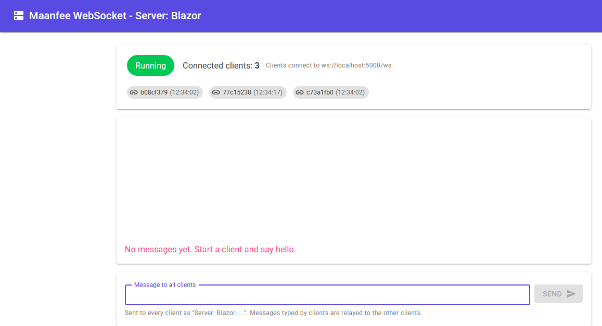
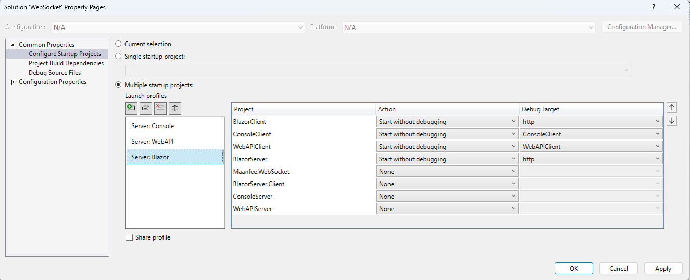
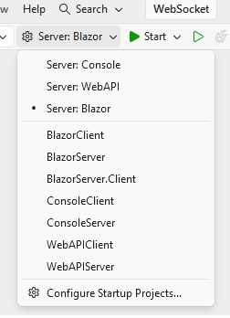

<div align="center">
  <picture>
    
  </picture>
  <h2 align="center">
        Maanfee WebSocket
  </h2>
  <p align="center">
        A focused WebSocket transport library for .NET: connections, messages, a server and a client. Higher-level features (users, groups, RPC, broadcast) belong to the layer built on top of it.
  </p>
</div>

## ✨ Features

- ✅ **Text and binary messages** - Both directions, on server and client
- ✅ **Fragmentation handled for you** - `WebSocketMessageReader` reassembles frames into complete messages (server and client)
- ✅ **Connection management** - `IWebSocketConnectionManager` tracks live `WebSocketConnection`s
- ✅ **Safe concurrent sends** - Every connection serializes its own sends, so many callers can send at once
- ✅ **Configurable limits** - Maximum message size and frame buffer size
- ✅ **Clean lifecycle** - Graceful `StopAsync()` / `DisconnectAsync()`, `DisposeAsync()`, cancellable connect and retry
- ✅ **Reconnectable client** - Every connect gets a fresh socket; connect, disconnect and connect again just works
- ✅ **Retry on connect** - Configurable retry count and delay
- ✅ **State tracking** - Server and client states with change events
- ✅ **Logging** - `ILogger` based, silent when no logger is supplied
- ✅ **ASP.NET Core integration** - DI registration, hosted service and one middleware call
- ✅ **UTC timestamps** - Every time inside the library is UTC

## 🧱 Architecture

```
┌──────────────────────────────┐
│   Your hub / application     │   users, groups, RPC, broadcast, protocol, authorization
└──────────────┬───────────────┘
               │
┌──────────────▼───────────────┐
│       Maanfee.WebSocket      │   connection, connection manager,
│                              │   message reader / sender, server / client
└──────────────┬───────────────┘
               │
           WebSocket
               │
              TCP
```

The library deliberately knows nothing about users, groups, RPC or broadcasting. Build those on top of `IWebSocketConnectionManager` and `IWebSocketMessageSender`.

```
Maanfee.WebSocket/
├── Abstractions/   IWebSocketConnectionManager, IWebSocketMessageSender,
│                   IMaanfeeWebSocketServer, IMaanfeeWebSocketClient
├── Connections/    WebSocketConnection, WebSocketConnectionManager
├── Messaging/      WebSocketMessage, WebSocketPayloadType,
│                   WebSocketMessageReader, WebSocketMessageSender
├── Server/         MaanfeeWebSocketServer, MaanfeeWebSocketServerOptions,
│                   WebSocketServerMiddleware, WebSocketServerHostedService, ...
├── Client/         MaanfeeWebSocketClient, MaanfeeWebSocketClientOptions, ...
└── Extensions/     AddMaanfeeWebSocket, UseWebSocketServer
```

## 📦 Packages

### Maanfee.WebSocket

| Type | Purpose |
|------|---------|
| `MaanfeeWebSocketServer` | Accepts WebSocket connections, reads their messages, raises events |
| `MaanfeeWebSocketClient` | Connects to a server, sends and receives text and binary messages |
| `WebSocketConnection` | One connected WebSocket: `Id`, `ConnectedAt`, `DisconnectedAt` (UTC), `State`, `IsConnected`, `SendAsync`, `ReceiveAsync`, `CloseAsync` |
| `IWebSocketConnectionManager` | `Count`, `Add`, `Remove(id)`, `Get(id)`, `GetAll()`, `Clear()` |
| `IWebSocketMessageSender` | `SendAsync` a text or binary message to a connection id |
| `WebSocketMessage` | A complete received message: `ConnectionId`, `PayloadType`, `Payload` (raw bytes), `ReceivedAt` (UTC), `AsText()` |
| `WebSocketPayloadType` | `Text` or `Binary` |
| `WebSocketMessageReader` | Reads frames until a message is complete |
| `MaanfeeWebSocketServerOptions` | `Path`, `MaxMessageSize`, `BufferSize` |
| `MaanfeeWebSocketClientOptions` | `Host`, `Port`, `Path`, `MaxMessageSize`, `BufferSize`, `AutoRetryConnection`, `RetryCount`, `RetryDelay` |
| `WebSocketServerState` / `WebSocketClientState` | State enums |

### Maanfee.Examples
Example implementations demonstrating usage in different application types.

| Role | Example | Notes |
|------|---------|-------|
| Server | `Servers/BlazorServer` | ASP.NET Core host (`BlazorServer`) plus a Blazor WebAssembly dashboard (`BlazorServer.Client`, MudBlazor) on `http://localhost:5000`; the WebSocket endpoint is `ws://localhost:5000/ws`. The dashboard shows the server state, the connected clients and the chat log, and sends messages to all clients as `Server: Blazor: ...` |
| Server | `Servers/ConsoleServer` | Console chat server on `ws://localhost:5000/ws`. Shows what clients type as `Client: Console: ...` and relays it to the other clients; what you type is sent to all clients as `Server: Console: ...`. Type `exit` to stop |
| Server | `Servers/WebAPIServer` | ASP.NET Core Web API server on `ws://localhost:5000/ws` (and `http://localhost:5000`). Uses `AddMaanfeeWebSocket` + `UseWebSocketServer`, relays what clients type to the other clients and sends messages from the HTTP API to all clients as `Server: WebAPI: ...`. Endpoints are listed below |
| Client | `Clients/ConsoleClient` | Console chat client. What you type is shown on the server and on the other clients; messages from the server and other clients are printed. Type `exit` to quit |
| Client | `Clients/WebAPIClient` | ASP.NET Core Web API on `http://localhost:5001` that keeps a chat connection (with connect retry). Endpoints are listed below |
| Client | `Clients/BlazorClient` | Blazor WebAssembly app with MudBlazor on `http://localhost:5002`. Host and port fields, Connect/Disconnect, a message list and a message box (Enter sends). Runs the same `MaanfeeWebSocketClient` in the browser |

Each client prefixes its own lines with its name (`Console: ...`, `WebAPI: ...`, `Blazor: ...`), so the server shows `Client: Console: ...`, `Client: WebAPI: ...` or `Client: Blazor: ...`. All three servers listen on `http://localhost:5000`, so run **one server at a time**; every client connects there. Start the server first, then run as many clients as you like. Relaying between clients is application logic and lives in the example, not in the library.

#### BlazorServer (Blazor WebAssembly dashboard)

```bash
dotnet run --project Maanfee.WebSocket.Examples/Servers/BlazorServer/BlazorServer
```

The WebSocket server itself runs in the ASP.NET Core host (a WebAssembly app cannot listen for connections). The host serves the Blazor WebAssembly dashboard, which runs in the browser and talks to the host through `/api/chat/status`, `/api/chat/messages` and `/api/chat/send` (same endpoints as `WebAPIServer`, polled once a second). Open `http://localhost:5000`; the launch profile does it for you and sets the `Development` environment, which the host needs to serve the dashboard files from the referenced project.

Type a message in the dashboard and press Enter: every connected client shows `Server: Blazor: ...`.

#### WebAPIServer endpoints

Base address: `http://localhost:5000` (WebSocket clients connect to `ws://localhost:5000/ws`)

| Endpoint | Description |
|----------|-------------|
| `POST /api/chat/send` with body `{"message":"..."}` | Send a message from the server to all connected clients (`400` if `message` is empty) |
| `GET /api/chat/messages` | Chat log kept by the server (last 100 lines) |
| `GET /api/chat/status` | Server state and number of connected clients |

Example: send `Hello` from the server to every client

```bash
curl -X POST http://localhost:5000/api/chat/send \
  -H "Content-Type: application/json" \
  -d '{"message":"Hello"}'
```

Response (`recipients` is how many clients received it):

```json
{ "status": "sent", "recipients": 2 }
```

Every client shows `Server: WebAPI: Hello`.

#### WebAPIClient endpoints

Base address: `http://localhost:5001`

| Endpoint | Description |
|----------|-------------|
| `POST /api/chat/send` with body `{"message":"..."}` | Send a message (returns `409` if not connected, `400` if `message` is empty) |
| `GET /api/chat/messages` | Messages received so far (last 100) |
| `GET /api/chat/status` | Connection status |
| `POST /api/chat/reconnect` | Disconnect and connect again |

Example: send `Hello`

```bash
curl -X POST http://localhost:5001/api/chat/send \
  -H "Content-Type: application/json" \
  -d '{"message":"Hello"}'
```

Response:

```json
{ "status": "sent" }
```

The server shows it as `Client: WebAPI: Hello` and relays it to the other clients.

#### BlazorClient (WebAssembly)

```bash
dotnet run --project Maanfee.WebSocket.Examples/Clients/BlazorClient
```

Open `http://localhost:5002`, press **Connect** (default `127.0.0.1:5000`, path `/ws`), type a message and press Enter. Your messages appear in the theme's primary color, messages from the server in the secondary color, and messages from other clients in the default text color. The server must be running first.

The library runs unchanged in the browser. A few things behave differently there:
- the browser WebSocket API is used, so the client can only connect with `ws://` or `wss://` and cannot set custom headers;
- the server must be reachable from the browser (the console server accepts any origin);
- when the server closes the connection the client moves to `Disconnected` and raises `ConnectionClosed`, just like on the desktop.

# 🚀 Quick Start

### 📦 Installation

**Package Manager**
```xml
<PackageReference Include="Maanfee.WebSocket" Version="*" />
```

### Server (ASP.NET Core)

```csharp
using Maanfee.WebSocket;

var builder = WebApplication.CreateBuilder(args);

// Registers the server, connection manager, message sender and a hosted service
// that starts the server with the host and stops it gracefully on shutdown.
builder.Services.AddMaanfeeWebSocket(options =>
{
    options.Path = "/ws";                      // default
    options.MaxMessageSize = 10 * 1024 * 1024; // default, 0 = unlimited
});

var app = builder.Build();

// Accepts WebSocket upgrades on the configured path.
app.UseWebSocketServer();

var server = app.Services.GetRequiredService<MaanfeeWebSocketServer>();
var sender = app.Services.GetRequiredService<IWebSocketMessageSender>();

server.MaanfeeMessageReceived += async (_, message) =>
{
    if (message.PayloadType == WebSocketPayloadType.Text)
        await sender.SendAsync(message.ConnectionId, $"echo: {message.AsText()}");
    else
        await sender.SendAsync(message.ConnectionId, WebSocketPayloadType.Binary, message.Payload);
};

app.Run();
```

Without ASP.NET Core, create the manager yourself and share it with the sender:

```csharp
var connections = new WebSocketConnectionManager();
var sender = new WebSocketMessageSender(connections);
var server = new MaanfeeWebSocketServer(new MaanfeeWebSocketServerOptions(), connections);
server.Start();
// pass every accepted System.Net.WebSockets.WebSocket to:
// await server.HandleWebSocketConnectionAsync(webSocket);
```

### Client

```csharp
await using var client = new MaanfeeWebSocketClient(new MaanfeeWebSocketClientOptions
{
    Host = "127.0.0.1",
    Port = 5000,
    Path = "/ws",                  // must match the server
    AutoRetryConnection = true,
    RetryCount = 3,
    RetryDelay = TimeSpan.FromSeconds(5),
});

client.MessageReceived += (_, text) => Console.WriteLine(text);          // text only
client.RawMessageReceived += (_, message) => { /* text and binary */ };

await client.ConnectAsync(cancellationToken);
await client.SendTextAsync("hello");
await client.SendBinaryAsync(new byte[] { 1, 2, 3 });

await client.DisconnectAsync();
await client.ConnectAsync();       // connecting again is supported
```

### Logging

The library logs through `ILogger`. In ASP.NET Core the server gets its logger from DI. For a client or a hand-built server, pass an `ILogger<T>` to the constructor; without one nothing is logged.

# 🛠️ API Reference

## MaanfeeWebSocketServer

| Member | Description |
|--------|-------------|
| `Start()` | Start the server (done for you by the hosted service in ASP.NET Core) |
| `StopAsync()` | Graceful stop: closes every connection and returns once all of them were removed and their `Disconnected` event fired |
| `HandleWebSocketConnectionAsync(WebSocket)` | Run one accepted WebSocket until it ends |
| `DisposeAsync()` | Graceful stop, then release resources |
| `Dispose()` | Releases resources only and aborts remaining connections; it never waits |
| `State` | Current `WebSocketServerState` |

Connections are not listed on the server. Inject `IWebSocketConnectionManager` for `Count`, `Get(id)` and `GetAll()`, and `IWebSocketMessageSender` for sending.

| Events | Description |
|--------|-------------|
| `MaanfeeClientConnected` | A connection was opened (`e.Connection`) |
| `MaanfeeClientDisconnected` | A connection is gone: removed from the manager and disposed (`e.Connection`) |
| `MaanfeeMessageReceived` | A complete text or binary message arrived (`WebSocketMessage`) |
| `MaanfeeServerStopped` | The server stopped |
| `StateChanged` | The server state changed |

## IWebSocketConnectionManager

| Member | Description |
|--------|-------------|
| `Count` | Number of registered connections |
| `Add(WebSocketConnection)` | Register a connection |
| `Remove(string connectionId)` | Remove by id, returns whether it existed |
| `Get(string connectionId)` | Find by id, `null` if unknown |
| `GetAll()` | Snapshot of all connections |
| `Clear()` | Remove everything |

## IWebSocketMessageSender

| Member | Description |
|--------|-------------|
| `SendAsync(connectionId, string)` | Send a text message |
| `SendAsync(connectionId, WebSocketPayloadType, ReadOnlyMemory<byte>)` | Send a text or binary message |

Both return `false` when the connection does not exist or is not open. Concurrent sends to the same connection are serialized.

## MaanfeeWebSocketClient

| Member | Description |
|--------|-------------|
| `ConnectAsync(CancellationToken)` | Connect. Each call uses a fresh socket; with `AutoRetryConnection` it retries, and the token cancels the attempt and the retry delay |
| `SendAsync(WebSocketPayloadType, ReadOnlyMemory<byte>, CancellationToken)` | Send a message of the given type |
| `SendTextAsync(string, CancellationToken)` | Send a text message |
| `SendBinaryAsync(ReadOnlyMemory<byte>, CancellationToken)` | Send a binary message |
| `DisconnectAsync()` | Graceful close |
| `DisposeAsync()` | Graceful disconnect (whatever the state), then release resources |
| `Dispose()` | Releases resources only; it never waits |
| `State` | Current `WebSocketClientState` |

| Events | Description |
|--------|-------------|
| `MessageReceived` | A text message arrived (decoded as UTF-8) |
| `RawMessageReceived` | Any message arrived, with its raw payload (`WebSocketMessage`) |
| `ConnectionClosed` | The connection closed (by the server, the network or `DisconnectAsync`) |
| `ErrorOccurred` | An error occurred |
| `Connected` | The connection was established |
| `StateChanged` | The client state changed |

The client does not reconnect by itself after the connection is lost. It moves to `Disconnected` and you call `ConnectAsync` again.

## Options

| `MaanfeeWebSocketServerOptions` | Default | Description |
|---------------------------------|---------|-------------|
| `Path` | `/ws` | URL path that accepts WebSocket connections |
| `MaxMessageSize` | 10 MB | Largest accepted message; larger ones close the connection with `MessageTooBig`. `0` = unlimited |
| `BufferSize` | 4096 | Frame read buffer in bytes |

| `MaanfeeWebSocketClientOptions` | Default | Description |
|---------------------------------|---------|-------------|
| `Host` | `127.0.0.1` | Server host |
| `Port` | `5000` | Server port |
| `Path` | `/ws` | Server endpoint, must match the server's `Path` |
| `MaxMessageSize` | 10 MB | Largest accepted message. `0` = unlimited |
| `BufferSize` | 4096 | Frame read buffer in bytes |
| `AutoRetryConnection` | `false` | Retry when connecting fails |
| `RetryCount` | `3` | Number of connect attempts |
| `RetryDelay` | 5 s | Wait between attempts |

The client connects with `ws://` only.

# Solution Configuration Guide

## Steps to Configure Multiple Startup Projects

1. **Open the Solution**
   - Right-click on the solution name in the Solution Explorer

2. **Access Solution Properties**
   - Go to `Properties`

3. **Configure Startup Projects**
   - Navigate to `Multiple startup projects`

## Available Project Profiles

### Web API Server Profile
- **Server**: Web API Server
- **Clients**: 
  - Blazor
  - Web API 
  - Console

### Console Server Profile  
- **Server**: Console Server
- **Clients**:
  - Blazor
  - Web API
  - Console

### Blazor Server Profile (Recommended)
- **Server**: Blazor Server
- **Clients**:
  - Blazor
  - Web API
  - Console

## Configuration Options
Each profile allows you to set different combinations of server and client applications for testing and development purposes.

<div style="display: flex; gap: 20px; flex-wrap: wrap; justify-content: center;">
    <div style="text-align: center;">
        
    </div> 
    <div style="text-align: center;"> 
         
    </div>
</div>
